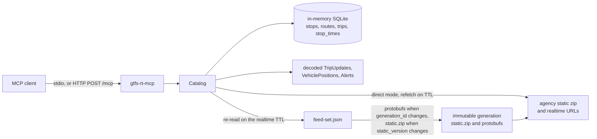

# gtfs-rt-mcp

MCP server that lets an agent read GTFS static schedules and GTFS-Realtime feeds. It is the agent-facing companion to a visual GTFS explorer: register a feed, then ask where a train is, how late it is, which track it was assigned, what the next departures are, and which alerts are active.

It works with any agency. A feed can be a static zip plus realtime protobuf URLs, or a feed-set document like the one published by [Amtrak-GTFS-RT](https://github.com/sohampatwardhan/Amtrak-GTFS-RT) at `/v1/feed-set.json`.

## Why Rust

The server is Rust because that is the same stack as the Amtrak GTFS-RT publisher, and it fits a long-running agent tool better than the other options that were open:

- The official Rust MCP SDK (`rmcp`) speaks stdio and streamable HTTP, and `prost` decodes the same GTFS-Realtime protobuf the publisher encodes.
- Static GTFS lands in an in-memory SQLite database (bundled, so the Pi does not need a system SQLite). Realtime messages stay decoded in memory and refresh on a TTL.
- One binary, about 9.4 MB stripped, links only glibc, libm, and libgcc. No JVM and no Python runtime. On a Raspberry Pi that means a small RSS and a predictable pause when a tool runs, without a garbage collector scanning a multi-million-row stop-time table.
- Python is a reasonable language for a one-shot script, and the GTFS libraries are convenient, but a resident interpreter plus protobuf and HTTP stacks is a larger and less predictable process for a Pi that is also publishing or proxying feeds.
- Java can host GTFS libraries, and it pays for that with a JVM that is large next to this binary.
- Swift is a good fit on macOS and less so for a small Linux MCP server with stdio and streamable HTTP.

The same crate builds on linux/arm64 and macOS. Release builds use thin LTO, `opt-level = "z"`, and stripped symbols.

## Architecture



Static GTFS is parsed once into SQLite. Feed-set generations are immutable: the server re-fetches `feed-set.json` when the realtime TTL expires, downloads the three protobufs only when `generation_id` changes, and downloads and re-parses `static.zip` only when `static_version` changes. Amtrak-GTFS-RT publishes a generation about every 45 seconds but keeps the same static bytes under each generation's URL until its static version changes, so the static zip is keyed by `static_version` rather than by its generation-scoped URL. A feed-set without `static_version` falls back to the URL. Direct agency URLs are mutable, so those bytes are fetched again on the TTL. A failed refresh keeps the last good copy and records `last_error` on `feed_health`.

Amtrak-GTFS-RT also deletes superseded generations (after `AMTRAK_GENERATION_RETAIN_SECS`, 600 by default, or beyond `AMTRAK_GENERATION_MAX`). If an artifact of the generation just read returns `404`, the server reads `feed-set.json` once more and loads the newer generation instead of recording an error.

## Build

Rust 1.88 or newer. The VM used for development was rustc 1.99.

Debian, Ubuntu, or Raspberry Pi OS:

```bash
sudo apt-get update
sudo apt-get install -y build-essential protobuf-compiler pkg-config
curl --proto '=https' --tlsv1.2 -sSf https://sh.rustup.rs | sh
cargo build --release --locked
./target/release/gtfs-rt-mcp --version
```

macOS:

```bash
brew install protobuf
cargo build --release --locked
```

`protobuf-compiler` (`protoc`) is required at build time. The GTFS-Realtime schema is vendored in `proto/gtfs-realtime.proto` (Apache-2.0, from the MobilityData GTFS-Realtime spec). Nothing is downloaded during `cargo test`.

## Run

Logs go to stderr. stdio mode must not print on stdout. The usual way to configure feeds is the `env` block of an MCP client (see below). The same variables work in a shell. A bad value is reported on stderr and in `list_feeds` / `feed_health`; the process still starts so the client can read the error. `register_feed` still works after startup.

```bash
# MBTA, public feeds, no API key. Already registered when the first tool runs.
GTFS_RT_MCP_FEED_ID=mbta \
GTFS_RT_MCP_STATIC=https://cdn.mbta.com/MBTA_GTFS.zip \
GTFS_RT_MCP_TRIP_UPDATES=https://cdn.mbta.com/realtime/TripUpdates.pb \
GTFS_RT_MCP_VEHICLE_POSITIONS=https://cdn.mbta.com/realtime/VehiclePositions.pb \
GTFS_RT_MCP_ALERTS=https://cdn.mbta.com/realtime/Alerts.pb \
gtfs-rt-mcp stdio

# Amtrak-style feed-set. The header value is a placeholder, not a real token.
GTFS_RT_MCP_FEED_ID=amtrak \
GTFS_RT_MCP_FEED_SET=http://127.0.0.1:8080/v1/feed-set.json \
GTFS_RT_MCP_HTTP_HEADERS='{"Authorization":"Bearer replace-me"}' \
gtfs-rt-mcp stdio

# The same fields as flags. A flag overrides only that field of the unindexed feed.
gtfs-rt-mcp --feed-id mbta --static https://cdn.mbta.com/MBTA_GTFS.zip stdio

# Streamable HTTP on 127.0.0.1:8091, MCP at /mcp, liveness at /healthz.
gtfs-rt-mcp http
```

There are no built-in credentials. Header values are sent on fetch and are never written to logs or tool results. `feed_health` and `list_feeds` return header names only.

HTTP accepts `Host: localhost`, `127.0.0.1`, and `::1` by default. Add `--allowed-host your-pi.local` when a non-loopback client connects. `GTFS_RT_MCP_BIND` sets the listen address (default `127.0.0.1:8091`). `GTFS_RT_MCP_ALLOWED_HOST` may be repeated. `GTFS_RT_MCP_LOG` or `RUST_LOG` sets the stderr tracing filter.

## Environment variables

Empty values are ignored. `http://` and `https://` are URLs; anything else is a filesystem path. A feed needs `FEED_SET` or `STATIC` (plus optional realtime URLs), not both.

### One feed

| Variable | Meaning |
| --- | --- |
| `GTFS_RT_MCP_FEED_SET` | `feed-set.json` URL or path. Artifact URLs come only from that document. |
| `GTFS_RT_MCP_FEED_ID` | Feed id. Default `default`. Letters, numbers, and `_` `.` `:` `-`, 1–64 characters. |
| `GTFS_RT_MCP_STATIC` | GTFS static zip URL or path. |
| `GTFS_RT_MCP_TRIP_UPDATES` | TripUpdates protobuf URL or path. |
| `GTFS_RT_MCP_VEHICLE_POSITIONS` | VehiclePositions protobuf URL or path. |
| `GTFS_RT_MCP_ALERTS` | Alerts protobuf URL or path. |
| `GTFS_RT_MCP_RT_TTL` | Realtime TTL in seconds. Integer 1–3600. Default 15. |
| `GTFS_RT_MCP_STATIC_TTL` | Direct static-zip TTL in seconds. `0` disables the timer. Max 604800. Default 21600. |
| `GTFS_RT_MCP_HTTP_HEADERS` | JSON object of header name to string value, for example `{"x-api-key":"replace-me"}`. |

`--feed-set`, `--feed-id`, `--static`, `--trip-updates`, `--vehicle-positions`, `--alerts`, `--rt-ttl`, `--static-ttl`, and `--http-headers` override the matching variable above. They do not override numbered feeds or `GTFS_RT_MCP_FEEDS`.

### Several feeds

Use numbered variables **or** `GTFS_RT_MCP_FEEDS`, not both. Setting both records a configuration error and registers neither set. The unindexed feed above can sit next to one of those styles. Indexes start at 1, have no gaps, and stop at 32. A missing id becomes `feed1`, `feed2`, and so on. Two feeds with the same id are both dropped.

| Variable | Meaning |
| --- | --- |
| `GTFS_RT_MCP_FEED_<n>_ID` | Feed id. |
| `GTFS_RT_MCP_FEED_<n>_NAME` | Alias of `_ID`. If both are set and differ, the error is reported and `_ID` is used. |
| `GTFS_RT_MCP_FEED_<n>_FEED_SET` | Feed-set URL or path. |
| `GTFS_RT_MCP_FEED_<n>_STATIC` | Static zip URL or path. |
| `GTFS_RT_MCP_FEED_<n>_TRIP_UPDATES` | TripUpdates URL or path. |
| `GTFS_RT_MCP_FEED_<n>_VEHICLE_POSITIONS` | VehiclePositions URL or path. |
| `GTFS_RT_MCP_FEED_<n>_ALERTS` | Alerts URL or path. |
| `GTFS_RT_MCP_FEED_<n>_RT_TTL` | Realtime TTL. Same limits as `GTFS_RT_MCP_RT_TTL`. |
| `GTFS_RT_MCP_FEED_<n>_STATIC_TTL` | Static TTL. Same limits as `GTFS_RT_MCP_STATIC_TTL`. |
| `GTFS_RT_MCP_FEED_<n>_HTTP_HEADERS` | JSON object of header strings. |
| `GTFS_RT_MCP_FEEDS` | JSON array of feed objects. See the field names below. |

`GTFS_RT_MCP_FEEDS` objects accept `id` / `name` / `feed_id`, `feed_set` / `feedSet`, `static` / `static_url` / `static_path`, `trip_updates` / `tripUpdates`, `vehicle_positions` / `vehiclePositions`, `alerts`, `rt_ttl_secs` / `rt_ttl`, `static_ttl_secs` / `static_ttl`, and `headers` / `http_headers`. A missing id becomes `feed1`, `feed2`, and so on.

```bash
GTFS_RT_MCP_FEEDS='[
  {"id":"mbta","static":"https://cdn.mbta.com/MBTA_GTFS.zip","trip_updates":"https://cdn.mbta.com/realtime/TripUpdates.pb","vehicle_positions":"https://cdn.mbta.com/realtime/VehiclePositions.pb","alerts":"https://cdn.mbta.com/realtime/Alerts.pb"},
  {"id":"amtrak","feed_set":"http://127.0.0.1:8080/v1/feed-set.json","headers":{"Authorization":"Bearer replace-me"}}
]' gtfs-rt-mcp stdio
```

Invalid JSON, a skipped index, a bad TTL, an unknown suffix, or a feed that fails to download is listed in `config_errors` or as a feed row with `"ready": false`. Header values are replaced with `[redacted]` if they would otherwise appear in an error. `refresh_feed` retries a row that failed at startup. A later `register_feed` with the same id replaces it.

## Docker

The image is multi-arch. Buildx builds each platform natively (or under QEMU) from the same Dockerfile, so a Raspberry Pi and an amd64 host produce their own binaries.

```bash
docker buildx build --platform linux/amd64,linux/arm64 -t gtfs-rt-mcp .
docker run --rm -p 8091:8091 gtfs-rt-mcp
```

The runtime image is `debian:bookworm-slim` plus CA certificates, running as uid 10001. The process listens on `0.0.0.0:8091` inside the container. From the host, `http://127.0.0.1:8091/mcp` matches the default allowed hosts.

The release binary built on this x86_64 machine is **9,843,096 bytes (9.4 MB)**, stripped, dynamically linked to glibc. The amd64 image built from this Dockerfile (`gtfs-rt-mcp:0.1.0`) uses **140 MB** of disk once `debian:bookworm-slim` is unpacked, and its content size is **35.2 MB**. `docker run --rm --entrypoint gtfs-rt-mcp gtfs-rt-mcp:0.1.0 --version` prints `gtfs-rt-mcp 0.1.0`.

## MCP clients

Put the binary on `PATH`, or use an absolute `command`. `args` must include `stdio`. Feeds in `env` are registered before the first tool call, so the model does not need `register_feed` for those feeds. `replace-me` below is a placeholder: substitute the publisher's token and do not commit a real one. The server never echoes that value.

Cursor `.cursor/mcp.json` (MBTA, no API key):

```json
{
  "mcpServers": {
    "gtfs-rt": {
      "command": "gtfs-rt-mcp",
      "args": ["stdio"],
      "env": {
        "GTFS_RT_MCP_FEED_ID": "mbta",
        "GTFS_RT_MCP_STATIC": "https://cdn.mbta.com/MBTA_GTFS.zip",
        "GTFS_RT_MCP_TRIP_UPDATES": "https://cdn.mbta.com/realtime/TripUpdates.pb",
        "GTFS_RT_MCP_VEHICLE_POSITIONS": "https://cdn.mbta.com/realtime/VehiclePositions.pb",
        "GTFS_RT_MCP_ALERTS": "https://cdn.mbta.com/realtime/Alerts.pb"
      }
    }
  }
}
```

Claude Desktop `claude_desktop_config.json` (Amtrak feed-set on localhost):

```json
{
  "mcpServers": {
    "gtfs-rt": {
      "command": "gtfs-rt-mcp",
      "args": ["stdio"],
      "env": {
        "GTFS_RT_MCP_FEED_ID": "amtrak",
        "GTFS_RT_MCP_FEED_SET": "http://127.0.0.1:8080/v1/feed-set.json",
        "GTFS_RT_MCP_HTTP_HEADERS": "{\"Authorization\":\"Bearer replace-me\"}"
      }
    }
  }
}
```

Claude Code `.mcp.json` (MBTA and the Amtrak feed-set together):

```json
{
  "mcpServers": {
    "gtfs-rt": {
      "command": "gtfs-rt-mcp",
      "args": ["stdio"],
      "env": {
        "GTFS_RT_MCP_FEEDS": "[{\"id\":\"mbta\",\"static\":\"https://cdn.mbta.com/MBTA_GTFS.zip\",\"trip_updates\":\"https://cdn.mbta.com/realtime/TripUpdates.pb\",\"vehicle_positions\":\"https://cdn.mbta.com/realtime/VehiclePositions.pb\",\"alerts\":\"https://cdn.mbta.com/realtime/Alerts.pb\"},{\"id\":\"amtrak\",\"feed_set\":\"http://127.0.0.1:8080/v1/feed-set.json\",\"headers\":{\"Authorization\":\"Bearer replace-me\"}}]"
      }
    }
  }
}
```

The same `mcpServers` objects work in any of the three files. Numbered variables are the other multi-feed form, for a client that prefers one variable per field:

```json
{
  "mcpServers": {
    "gtfs-rt": {
      "command": "gtfs-rt-mcp",
      "args": ["stdio"],
      "env": {
        "GTFS_RT_MCP_FEED_1_ID": "mbta",
        "GTFS_RT_MCP_FEED_1_STATIC": "https://cdn.mbta.com/MBTA_GTFS.zip",
        "GTFS_RT_MCP_FEED_1_TRIP_UPDATES": "https://cdn.mbta.com/realtime/TripUpdates.pb",
        "GTFS_RT_MCP_FEED_1_VEHICLE_POSITIONS": "https://cdn.mbta.com/realtime/VehiclePositions.pb",
        "GTFS_RT_MCP_FEED_1_ALERTS": "https://cdn.mbta.com/realtime/Alerts.pb",
        "GTFS_RT_MCP_FEED_2_ID": "amtrak",
        "GTFS_RT_MCP_FEED_2_FEED_SET": "http://127.0.0.1:8080/v1/feed-set.json",
        "GTFS_RT_MCP_FEED_2_HTTP_HEADERS": "{\"Authorization\":\"Bearer replace-me\"}"
      }
    }
  }
}
```

Cursor streamable HTTP (start `gtfs-rt-mcp http` first; it reads the same environment):

```json
{
  "mcpServers": {
    "gtfs-rt": {
      "url": "http://127.0.0.1:8091/mcp"
    }
  }
}
```

The server name is `gtfs-rt-mcp`. Instructions on `initialize` tell the model to call `list_feeds` first. Responses are compact JSON. Page with `offset` until `next_offset` is null.

## Tools

| Tool | What it answers |
| --- | --- |
| `register_feed` | Load a feed-set URL or a static zip plus realtime URLs. Replaces the same `feed_id`, including a startup row that failed. |
| `list_feeds` | Registered feeds, `ready`, and `config_errors` from startup. Header names only. |
| `unregister_feed` | Drop a feed and its caches. |
| `refresh_feed` | Re-read now. Retries a feed that failed at startup. Feed-set static files reload only when the generation changes. |
| `feed_health` | Counts, header timestamps, age, TTL, last error, generation, and `config_errors`. |
| `search_stops` | `stop_id`, code, or name. Default 20, max 100. |
| `search_routes` | `route_id`, short name, or long name. |
| `trip_status` | Where a trip is. `trip` is a `trip_id` or `trip_short_name` (train number). Optional `stop` fills delay and track. |
| `trip_schedule` | Stop sequence with scheduled and estimated times. |
| `departure_board` | Station board: static schedule plus realtime delay, cancellation, and track. |
| `vehicle_positions` | Live positions. Filter by route, trip, vehicle, or stop. |
| `trip_updates` | Delays and `assigned_stop_id`. A stop filter matches `stop_id` or the static stop at that `stop_sequence`. |
| `alerts` | Cause, effect, severity, periods, informed entities, and clipped text. |
| `decode_protobuf` | One FeedMessage from a path, http(s) URL, or base64 string. Does not register a feed. |

`feed_id` may be omitted when one feed is registered. `at_unix` pins the clock; omit it to use the current time. Delays are seconds, and positive means late. `track` is the static `platform_code` of `assigned_stop_id` when that stop exists, otherwise the scheduled platform.

Limits: list tools default to 20 rows and cap at 100. `trip_updates` keeps 8 stop updates per trip (max 40). Alert text defaults to 400 characters (max 2000). `decode_protobuf` returns 20 entities (max 100).

Up to 16 feeds can be registered. Realtime TTL defaults to 15 seconds (1–3600). Direct static zips refresh every 6 hours unless `static_ttl_secs` is `0`. Downloads are capped at 250 MB for a static zip and 80 MB for a realtime message.

## Feed-set documents

`register_feed` with `feed_set` reads a JSON document and uses only the URLs inside it. It does not invent `/v1/generations/{id}/...` paths.

```json
{
  "generation_id": "gen-1",
  "generated_at_unix": 1768494600,
  "static_version": "harbor-1",
  "urls": {
    "static_zip": "/v1/generations/gen-1/static.zip",
    "trip_updates": "/v1/generations/gen-1/trip-updates.pb",
    "vehicle_positions": "/v1/generations/gen-1/vehicle-positions.pb",
    "alerts": "/v1/generations/gen-1/alerts.pb"
  }
}
```

Resolution:

- `http://` and `https://` are used as written.
- A path that starts with `/` is joined to the manifest's origin. `https://feeds.example/v1/feed-set.json` plus `/v1/generations/gen-1/static.zip` becomes `https://feeds.example/v1/generations/gen-1/static.zip`.
- A relative path is resolved next to the manifest. From a file, that is the manifest's directory.
- A manifest loaded over HTTP rejects `file://` URLs, so a remote document cannot point the server at local files. Loopback HTTP is allowed, because a publisher may listen only on localhost.

The artifact names above match the Amtrak publisher (`static.zip`, `trip-updates.pb`, `vehicle-positions.pb`, `alerts.pb`). Other names work when the document says so. Track assignments follow the publisher's convention: `stop_time_properties.assigned_stop_id` such as `NHV:track:12`, often with `stop_sequence` set and `stop_id` omitted. Static GTFS can carry a parent station and platform stops whose `platform_code` is the track label. Stop updates match `stop_sequence` first, then `stop_id`. A delay carries forward from the previous stop until the next update; `NO_DATA`, `SKIPPED`, and an assigned platform do not. An absolute `time` wins over `delay`.

## Example: Harbor fixture

The checked-in Harbor Line fixture is a small feed-set with no network. Clock is 2026-01-15 11:30 America/New_York (`at_unix` 1768494600). Train 177 (`trip_short_name`) is the Northeast Corridor trip `177-BOS`, in transit to New Haven.

`trip_status` with `trip: "177"`, `stop: "NHV"`, `at_unix: 1768494600` returns, in part:

```json
{
  "trip_id": "177-BOS",
  "trip_short_name": "177",
  "route_short_name": "NEC",
  "delay_sec": 480,
  "delay_label": "8 min late",
  "vehicle": {
    "status": "IN_TRANSIT_TO",
    "stop_id": "NHV",
    "lat": 41.25,
    "lon": -72.95,
    "vehicle": { "label": "177" }
  },
  "at_stop": {
    "stop_id": "NHV",
    "scheduled_departure_local": "12:04",
    "estimated_departure_local": "12:12",
    "arrival_delay_sec": 420,
    "departure_delay_sec": 480,
    "assigned_stop_id": "NHV:track:12",
    "platform_code": "12",
    "track": "12"
  }
}
```

`departure_board` at New Haven for the next 120 minutes, ignoring anything that left more than 5 minutes ago, returns train 177 on track 12 at 12:12, then bus B1 at 12:30. Train 66 left at 11:15, so it is outside the window. Asking for the platform stop `NHV:track:12` still shows 177, because the board expands to the parent station and sibling platforms.

`alerts` with `route: "NEC"` returns one alert, header `Track work between NYP and NHV`, effect `SIGNIFICANT_DELAYS`. A local-bus detour in the same feed does not match.

`decode_protobuf` on `trip-updates.pb` shows the second stop update's `assigned_stop_id` of `NHV:track:12`.

## Example: MBTA

This was run from the development VM against the public MBTA feeds (no API key): `https://cdn.mbta.com/MBTA_GTFS.zip` and the realtime protobufs under `https://cdn.mbta.com/realtime/`. The static feed was Fall 2026 (`10,292` stops, `3,104,937` stop times, `117,449` trips). The dominant agency is MBTA in `America/New_York`. At fetch time the vehicle feed had 349 entities and was 1 second old; trip updates had 1,184 entities.

`search_stops` for `South Station` ranks the station `place-sstat` first.

`departure_board` at that station, `window_minutes: 90`, `limit: 5`, expanded 25 platforms (not pathway nodes) and returned 83 departures. The first page started with:

- Providence/Stoughton train 889, scheduled 22:45
- Red Line to Alewife, 22:47
- Silver Line Way SLW, 22:53
- SL2 from Design Center, reported 7 min early (`delay_sec: -398`)
- SL1 from Logan, `delay_label: "on time"` (`delay_sec: 22`)

`vehicle_positions` with `limit: 3` included bus 0803 on route 220, `IN_TRANSIT_TO` Washington St @ Foster St, occupancy `MANY_SEATS_AVAILABLE`.

`alerts` with `active_only: true` and `limit: 3` returned 3 of 97, including the Providence Station stairwell closure on the Providence/Stoughton Line.

Re-run that check locally with:

```bash
cargo test --test live_mbta -- --ignored --nocapture
```

CI does not run it. `cargo test` uses the Harbor fixture and loopback feed-set servers only.

## Tests and CI

```bash
cargo test --locked
```

GitHub Actions (`.github/workflows/ci.yml`) installs `protoc`, runs `cargo test --locked`, and builds the release binary. No network is required for the default tests.

## Layout

- `src/mcp.rs` — tool schemas and stdio / streamable HTTP serving
- `src/config.rs` — startup feed registration from environment variables and flags
- `src/catalog.rs` — feed registry, TTL refresh, last-good cache
- `src/gtfs.rs` — static zip to in-memory SQLite
- `src/realtime.rs` — protobuf decode, delay labels, platform fields
- `src/query.rs` — trip status, boards, vehicles, alerts
- `src/source.rs` — feed-set URL resolution and capped downloads
- `tests/fixtures/harbor/` — tiny GTFS text files
- `proto/gtfs-realtime.proto` — vendored spec, Apache-2.0
